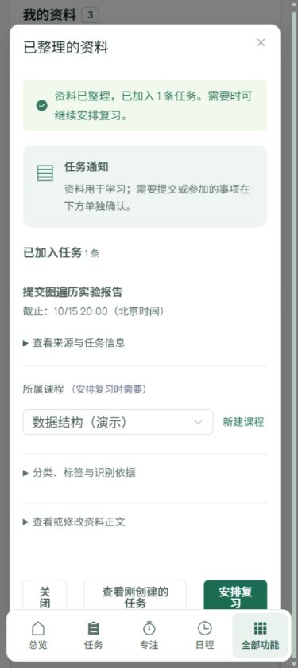
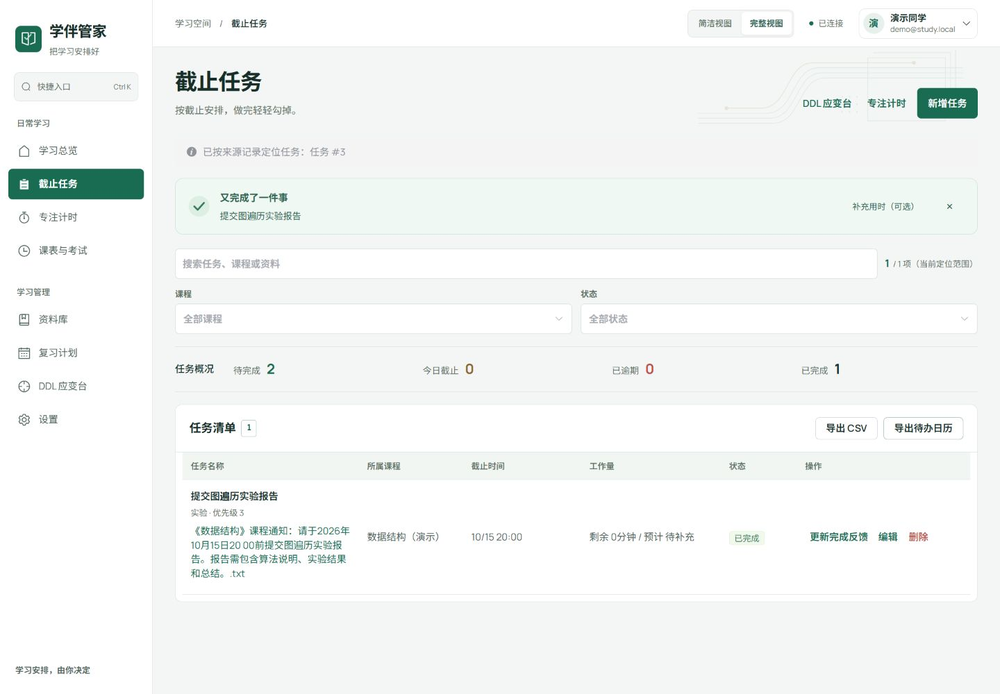

# 学伴管家比赛最终验收

验收日期：2026-10-06。对象：本地当前工作区，包含已有未提交修改。赛道：中兴赛道「学习 DDL 与资料管理智能体」。

## 验收结论

**本地自动化回归和本轮网页核心操作通过；参赛提交材料未齐，不能标记为最终交付完成。**

本轮修复了浏览器时区导致的 DDL 确认错时，以及报告内容要求被误拆为任务的问题。没有发布、上传参赛材料或创建提交包。用户确认项目外也没有最终视频、正式报告或合规签字页。

## 实际执行结果

| 检查 | 本次结果 | 证据 |
| --- | --- | --- |
| Python 依赖一致性 | 通过 | `pip check`：No broken requirements found |
| 后端完整测试 | **452 passed，1 warning，22.59 秒** | `.tmp/final-acceptance-2026-10-06-final-pass.log` |
| 前端完整 verify | **通过**：lint、全部已接入契约、生产构建、延迟加载检查和包体预算 | 同上 |
| Android 单元测试 | **18 项通过，0 失败，0 错误** | `android/app/build/test-results/testDebugUnitTest/TEST-*.xml` |
| Android lint | **No issues found** | `android/app/build/reports/lint-results-debug.txt` |
| Android Debug 打包 | **BUILD SUCCESSFUL，44 秒** | `.tmp/final-acceptance-2026-10-06-android-verified.log` |
| 实际网页 | 演示登录、粘贴通知入库、本地识别、课程选择、人工确认、来源定位、任务完成通过 | 下方截图 |
| 响应式抽检 | 375×840 的资料确认框、任务页及 1440×1000 的任务页无页面级横向溢出 | 实测 `scrollWidth == clientWidth`；任务页手机宽度扣除滚动条为 365px |
| 日历导出 | 网页按钮触发 `/api/exports/tasks.ics`，后端返回 200；接口内容测试通过 | `.tmp/final-acceptance-2026-10-06-api-fixed.log` |
| 工作区差异格式 | `git diff --check` 通过 | 本轮执行 |

后端 warning 是 Starlette TestClient 对当前 httpx 集成的弃用提示，不是业务失败。构建仍有第三方 PURE annotation 提示。没有为消除提示升级依赖。

Android 首次因 Gradle 下载超时失败；复用 `.tmp/android-gradle-audit` 缓存后，沙箱仍阻止读取已安装 SDK；获得工具自动审批后，以离线缓存、现有 SDK 完成上述三项检查。不能将前两次环境失败写成代码失败，也不能把最终 Debug 构建结果当作真机验收或正式签名发布。

日历下载等待未返回可验证的本地文件路径，因此**不认定浏览器文件落盘、系统日历导入或提醒触发已验收**。

## 本轮发现与修复

### DDL 确认受浏览器时区影响

输入「请于2026年10月15日20:00前提交图遍历实验报告」，后端正确返回 UTC 12:00。旧资料页使用浏览器的本地日期字段生成无时区表单值；在 America/Los_Angeles 下变成 05:00，接口又把它当北京时间保存，改变了真实截止时刻。

现改为统一转换成北京时间输入值，校验也采用北京时间日历字段。确认提示明确说明时区，确认后的结果显示北京时间。新增覆盖 UTC、Asia/Shanghai、America/Los_Angeles 及美国夏令时切换日的回归。实际网页确认前后均为 **10/15 20:00**。

涉及 `frontend/src/views/MaterialsView.vue`、`frontend/src/components/ExtractionReviewContent.vue`、`frontend/tests/contracts/check-paste-notice.mjs`。

### 内容要求被误识别成额外任务

同一通知后接「报告需包含算法说明、实验结果和总结」，旧本地规则生成两条候选。现将没有独立行动或截止时间的内容要求作为说明保留；有明确提交行动的同类句子仍可识别。新增两项后端回归，实际网页重新识别后只有 **1 条任务**。

涉及 `backend/app/services/llm_provider.py`、`backend/tests/test_material_parsing_reliability.py`。

### 旧测试没有同步缺省时刻提示

首轮完整测试为 449 passed / 1 failed。纯日期现在默认北京时间 23:59，并给出 `TIME_DEFAULTED_TO_END_OF_DAY` 复核提示；旧容量测试仍要求没有提示。保留产品提示，更新测试，并加强 23:59 和同一北京时间日期的断言。

涉及 `backend/tests/api/test_capacity_api.py`。

## 本轮可复用的用例结果

以下是本轮完整测试中的代表性证据，可整理进附件4；每项均需保留“接口自动化”与“网页操作”的区别，不能写成真实用户识别准确率。

| 编号 | 类型 | 输入与前置条件 | 预期及本次实际结果 | 测试证据 |
| --- | --- | --- | --- | --- |
| FA-01 | 正常 | 隔离账号、课程、通知文件 | 注册登录→上传→确认→检索→完成→计划→四类导出连续接口闭环通过 | `integration/test_reviewer_reproduction_smoke.py::test_reviewer_can_reproduce_the_complete_learning_loop_without_real_data` |
| FA-02 | 正常 | 图遍历通知含明确日期和报告内容要求 | 仅一条提交任务；截止保持 UTC 12:00 / 北京时间 20:00；确认后可读取 | `test_material_parsing_reliability.py::test_report_content_requirements_do_not_create_extra_tasks`；另有网页操作 |
| FA-03 | 边界 | 内容要求句还含独立提交行动 | 不误过滤真实任务 | `test_material_parsing_reliability.py::test_report_requirements_with_separate_submission_keep_the_task` |
| FA-04 | 边界 | UTC、上海、洛杉矶浏览器日期环境 | 同一候选转换后截止时刻不变，包含夏令时边界 | `frontend/tests/contracts/check-paste-notice.mjs` |
| FA-05 | 边界 | 只有日期，没有时刻 | 默认上海 23:59，有警告；容量按上海日期分组 | `api/test_capacity_api.py::test_extraction_deadline_is_utc_and_capacity_groups_by_shanghai_local_date` |
| FA-06 | 异常 | 外部 Provider 的 warnings 为 null | 安全记录识别失败，不抛出未处理 500、不生成任务 | `test_material_parsing_reliability.py::test_null_candidate_warnings_records_failure_instead_of_server_error` |
| FA-07 | 异常 | Provider 日期与原文实际冲突 | 要求人工复核，不采用冲突日期 | `test_material_parsing_reliability.py::test_iso_provider_still_rejects_actual_source_conflict` |
| FA-08 | 异常 | 两个账号中复用同一数字任务编号 | 专注记录不能跨账号绑定 | `api/test_focus_session_auth.py::test_focus_records_cannot_cross_accounts_with_reused_numeric_ids` |
| FA-09 | 边界 | 删除任务后复用数字编号，再重放旧回执 | 旧回执不能绑定新对象 | `api/test_deadline_radar_replay_identity.py::test_replay_cannot_bind_old_receipt_to_a_reused_task_id` |
| FA-10 | 异常 | 导入日历使用无法识别的时区 | 不能静默当作上海时区 | `api/test_calendar_import_edges.py::test_unrecognized_timezone_is_not_silently_assumed_to_be_shanghai` |
| FA-11 | 边界 | 重复确认同一抽取候选 | 不重复创建正式任务 | `api/test_api.py::test_m4_confirmed_candidate_cannot_be_confirmed_twice` |
| FA-12 | 正常 | 含不同状态和截止日期的任务 | 日历导出有上海时区、提前一天提醒、正确活动任务筛选 | `api/test_api.py::test_tasks_icalendar_export_has_timezone_alarm_and_active_filter` |

后端测试证据路径均相对于 `backend/tests/`。

## 官方清单与提交缺项

核对依据为本地 `competition/大赛资料/智能体创新实践大赛4.0/智能体创新实践大赛参赛手册.docx` 及附件2—5。手册要求中兴赛道提交可运行作品、技术文档、README、至少10条覆盖正常/异常/边界的用例、3—5分钟视频、合规说明。

| 提交项 | 状态 | 截止前动作 |
| --- | --- | --- |
| 可运行作品及评审入口 | 本地实现与回归通过；README 有部署说明和 DEMO_MODE；未做干净机器安装 | 固定当前版本，整理完整源码与启动说明，在干净目录复现 |
| 技术文档 | 已有架构与技术路线等基础文档；独立正式技术报告未完成 | 按附件3整理，纳入本轮结果、架构图与真实限制 |
| README | 已有环境、安装、启动、配置、测试说明，本轮更新验收基线 | 提交前补齐 FAQ 与依赖来源说明，核对评审入口 |
| 至少10条用例 | 既有正式用例表和本报告12条实际结果 | 按附件4整理输入、预期、实际结果、证据；不得把未做的手工项标通过 |
| 3—5分钟视频 | **缺失，用户确认未准备** | 优先录制完整学习闭环，可复用本轮通知；避免真实数据入镜 |
| 合规说明 | 已有 `docs/quality/合规与隐私说明.md` | 与实际提交内容一致；附件5签名和日期由成员完成 |
| 最终源码包 | 尚未形成冻结的提交包；当前有未提交修改和新增文件 | 不可仅导出旧 Git 提交，否则可能漏掉本次修复及此前新增模块 |

手册使用命题四，附件4仍把同名 DDL 场景列为命题三。材料统一使用完整命题名称，并以正式报名信息及组委会最新通知核对编号。手册没有精确截止时刻，只说明后续群通知为准；本轮没有验证最新群公告或提交平台回执。

打包应排除真实 `.env`、数据库、上传资料、私人日志、虚拟环境、node_modules、Gradle 缓存和整套赛事数据。报名表等个人材料仅用于比赛指定渠道。APK 可作为独立的可执行附件保留，不应把整个构建目录一并打包。

## 尚未验收的范围

公网部署、干净机器安装、Android 真机、外部 AI 真实质量、学校真实登录、系统日历提醒、完整辅助技术检查、正式视频和彩排均未由本轮证明。

当前抽检还看到外部 AI 不可用时提示“可在设置中配置”，但实际配置在服务端，属于待修正文案。任务编辑和快捷任务仍有浏览器本地时区语义，与列表北京时间展示并不完全统一；本轮已修复的范围是**资料抽取确认造成实际截止偏移**，不宣称所有日期控件均完成跨时区验收。

本轮网页使用 `.tmp/final-acceptance-2026-10-06-runtime` 内的独立数据库和上传目录，端口 8016 / 5186，只写入脱敏演示通知。实际用户数据没有用于网页测试。

## 截图

手机确认后仅有一条任务，截止显示北京时间：

来源定位后的任务完成状态与正确截止时间：

## 复现

Web：项目根目录运行 `scripts/verify-local.ps1`。

Android：使用 Android README 所列 JDK / SDK，在 `android/` 运行 `gradlew.bat testDebugUnitTest lintDebug assembleDebug`。本机本次使用已有离线 Gradle 缓存，环境路径不是可分发依赖。

建议立即冻结新功能，优先完成视频、技术报告与用例整理、签字页、干净目录复现和最终打包。
