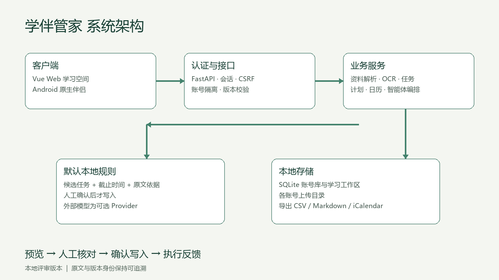
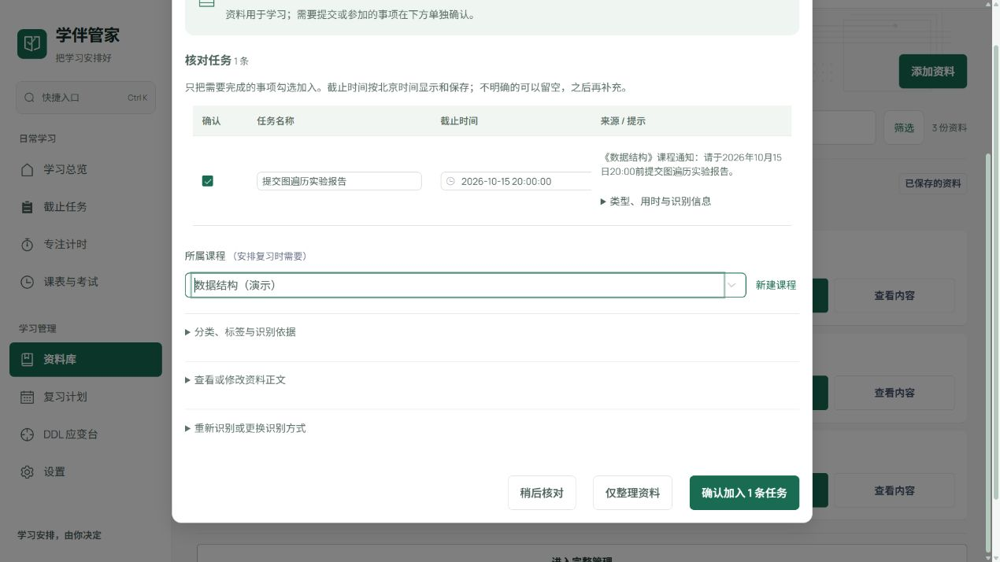

# 学伴管家技术报告

智能体创新实践大赛 · 学习 DDL 与资料管理智能体 · 2026 年 10 月 10 日提交候选版本

本报告按附件3的十项内容组织。作品提供可在本机运行的 Web 应用和 Android 伴侣；本次验证以本地规则模式为主。全部示例为合成课程材料，不包含真实学生信息。

## 一 摘要

大学生的课程通知、实验要求和复习资料分散在不同文件与消息中，截止时间容易遗漏，改期后也难以判断对既有安排的影响。学伴管家围绕“资料入库、结构化识别、人工确认、行动安排、完成反馈”构建本地学习智能体。系统采用 Vue 前端、FastAPI 服务、SQLite 工作区和原生 Android 伴侣，支持常见文档及图片解析，默认通过本地规则识别任务、课程、截止时间和来源片段；外部模型为可选能力，演示无需密钥。用户核对候选后才创建任务，日期不明确时保留复核提示。任务可生成复习安排，导出日历或清单；DDL 应变台可预览提前、延期和取消带来的变化。本次从独立目录重新安装依赖，后端463项测试及前端完整校验通过，Android18项单元测试、静态检查与调试包构建通过。浏览器实际完成通知入库、候选确认、计划生成、改期预演和任务管理，导出接口生成了可检查的样例文件。结果证明当前本地评审流程可复现，但不代表真实用户识别准确率或生产环境能力；真实日历提醒、外部模型效果和实体手机运行仍需进一步验证。

## 二 问题理解与业务场景

目标用户是需要整理课程材料、实验作业和考试复习安排的大学生。输入包括课程通知、PDF、DOCX、TXT、Markdown及图片；输出包括保留原文依据的任务候选、确认后的DDL、按可用时间生成的复习清单、任务状态和CSV、Markdown、iCalendar文件。

统一必测场景采用《学习DDL与资料管理智能体》对应要求：从课程通知或资料提取DDL并形成学习提醒或复习清单，体现入库、标签、检索和导出。参赛手册称命题四，附件4称命题三，编号存在差异，因此以完整命题名称和场景为准。

示例输入为“《数据结构》课程通知：请于2026年10月15日20:00前提交图遍历实验报告。报告需包含算法说明、实验结果和总结。”难点在于区分真正待办与报告内容要求，保持北京时间不随浏览器时区变化，并让每次自动建议都可核对、修改和拒绝。

## 三 总体技术路线

文件先校验类型和大小，再解析文本或触发OCR；原文和处理状态保存在当前账号的工作区。规则Provider输出结构化候选与来源片段，由页面提供人工复核，确认后才写入正式任务。计划服务从选定课程、资料、任务和每日可用时间生成安排；执行结果回流到任务及学习记录。

智能体能力以受约束的业务编排实现，重点是证据和确认边界。默认模式不调用外部大模型，也不把规则结果描述为大模型推理。部署者可以配置兼容接口，用户按次选择外部Provider；异常响应与超时进入安全失败路径。本轮未对外部模型做实测效果比较。

## 四 系统架构

浏览器和Android通过HTTP访问FastAPI。认证层验证会话与CSRF，并选择账号工作区；业务路由调用资料解析、抽取、任务、计划、日历和智能体服务。账号库独立保存会话及密码散列，学习数据与上传目录按工作区隔离。接口输出采用统一错误结构和请求标识。

代码入口：frontend/src负责页面与交互；backend/app/api负责HTTP边界；backend/app/services负责解析、抽取和编排；backend/app/models负责持久化；android/app/src/main提供移动伴侣。完整架构及认证迁移边界见docs/product/架构与技术路线.md。

## 五 核心算法与关键模块

通知抽取先识别行动与日期，再保留逐字来源片段。相对日期使用资料参考时间，明确时间按北京时间转换为UTC；只给日期时采用当日末尾并显式提示，模糊或冲突时间不强行补全。取消通知、纯信息通知、无独立行动的内容要求不应成为待办。本轮修复了报告内容条目误报及跨时区编辑、快捷添加和列表显示不一致。

写入与预览分离：抽取候选、变更预演和计划差异不自动修改正式任务。确认使用不可复用导航身份和版本前置条件，旧页面不能覆盖较新的结果，重复确认不能重复建任务。DDL应变台比较原截止、新截止与七日容量，缺少工作量时不会虚构精确超载量。

资料以内容哈希辅助去重，并保留解析失败状态和手动补文路径。任务来源、原文和确认结果可回查；资料删除后的任务仍保留来源说明。日历导出包含上海时区和提醒字段，但实际提醒由导入端决定。

## 六 数据与预处理

本次评审数据由合成课程通知、内置演示课程及仓库固定测试文件组成。核心字段包括课程、资料正文及类型、任务名称、截止时间、来源片段、状态、工作量、版本和导航身份。上传先校验20MB大小上限及允许格式，再进入文本解析或OCR；失败时保留原始文件并允许重试。

本地演示脚本将账号库、学习库和上传目录全部放入.tmp/reviewer-demo，避免与用户现有资料混用。源代码包排除.env、数据库、真实上传文件和报名表。AI辅助用于开发、文档整理及合成旁白；屏幕画面来自实际本地应用，视频采用关键画面讲解形式，不冒充连续录屏。开源来源和许可见THIRD_PARTY_NOTICES.md；不替代各依赖许可证。

## 七 实验设计与评估指标

自动化分三层：pytest覆盖后端接口、账号隔离、解析、抽取、计划、导出及并发边界；前端verify覆盖lint、行为契约、生产构建和资源预算；Android覆盖单元测试、lint与Debug构建。另在独立目录重新创建Python虚拟环境、安装锁定依赖并完整执行校验，降低已有环境缓存掩盖缺项的风险。

指标定义为测试通过数量、失败数量、构建结果和场景验收状态。463项测试不是463名用户，也不是抽取准确率。历史合成通知评测保留首次失败与调优后结果，参见docs/quality/独立通知评测-2026-09-10.md；已知集通过不能外推为陌生真实输入效果。没有随机真实数据、用户对照组或端到端延迟统计，本报告不报告这些指标。

复现命令为scripts/setup-reviewer.ps1、scripts/verify-local.ps1和scripts/run-isolated-smoke.ps1。评测用例文件列出正常、异常和边界场景及对应证据；界面流程和API导出分别记录，避免把接口成功等同于系统日历提醒成功。

## 八 测试结果与案例展示

2026年10月10日本地完整回归为463 passed、1 warning；全新目录安装后仍为463项通过，前端verify通过。Android为18项测试、0失败，lint和assembleDebug成功。残留第三方弃用及打包提示未导致检查失败；相关原始日志保存在本包evidence目录。

浏览器实际输入上述实验通知，得到1条“提交图遍历实验报告”，截止为10月15日20:00，原文依据可见。选择数据结构课程并确认后，任务列表及编辑表单仍显示相同北京时间。由该资料生成一份复习计划，再以明确提前通知预演新截止10月14日20:00；预览没有直接修改原任务。

本轮另从实际服务导出tasks.ics、tasks.csv、materials.md及study-plans/1.md，均返回HTTP200，文件见samples。历史2026年10月6日端到端验收与此次新增证据互补；旧文档的待办状态保留为历史，不作为当前提交入口。

## 九 部署与运行说明

在Windows安装Python3.14与Node.js24后，从仓库根目录运行scripts/setup-reviewer.ps1，再运行scripts/start-reviewer.ps1，访问http://127.0.0.1:5173并选择“体验示例空间”。首次安装需要网络，本地规则演示无需外部模型密钥。后端默认8000端口；端口占用时脚本报错，可通过ApiPort和WebPort参数同时切换。

启动脚本使用独立演示数据目录，后端日志位于.tmp/reviewer-demo。停止前台命令会清理本次启动的后端。API健康检查为/api/health，接口说明为/docs。源码中的.env.example仅为模板，实际密钥不应进入仓库。Android为可选伴侣，构建和ADB配置按android/README.md操作。

资料解析失败可补正文；模糊时间可手工确认；无外部模型时使用本地规则。演示模式限本地评审。生产部署仍需补充邮箱验证、密码恢复、限流、TLS、运维和备份策略。

## 十 不足分析与改进计划

规则抽取对复杂省略、多课程交叉指代、冲突通知和低质量OCR仍有局限，人工复核是当前产品流程的一部分。计划是基于可用时长的可编辑安排，尚无真实学习效果验证，不能保证成绩或任务完成率。

本轮没有进行真实教务账号登录、外部付费模型调用、系统日历提醒触发或实体Android设备验证，也未部署公网生产服务。下一步优先扩大授权脱敏通知集并盲测，补日历客户端及真机兼容性测试，再完善账号恢复与生产监控。合规承诺须由成员阅读并亲自签署，空白签字页不能视为已完成的承诺书。
